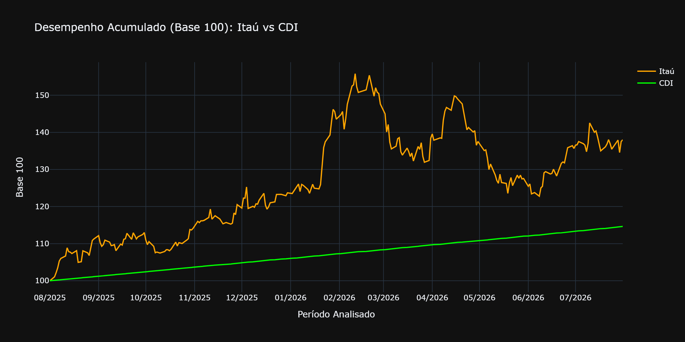
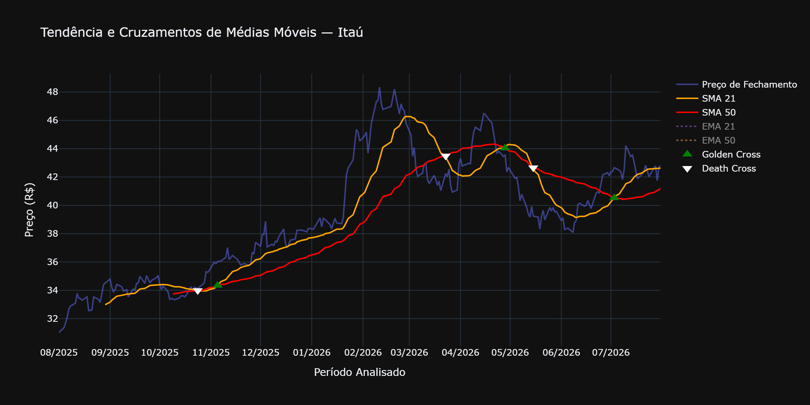
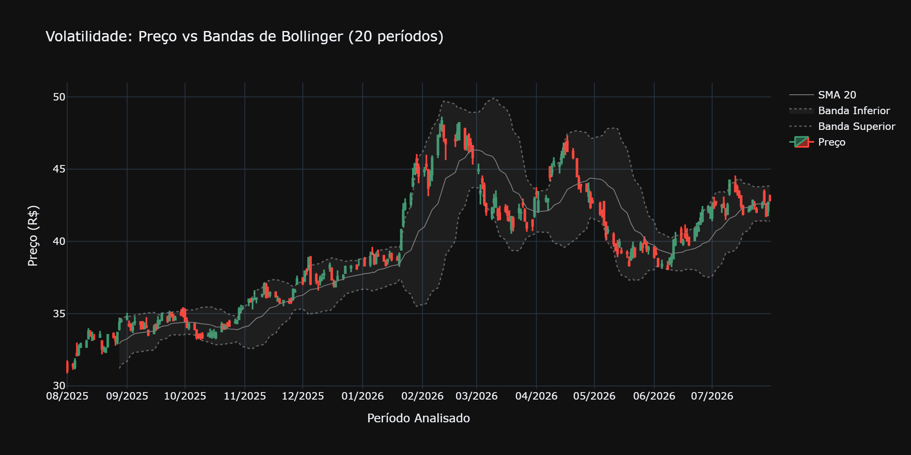
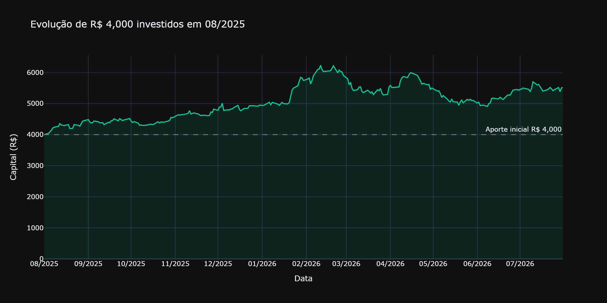
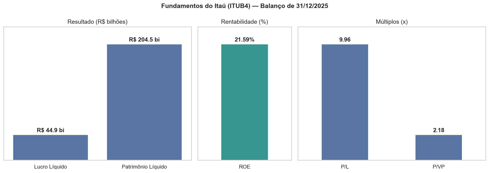
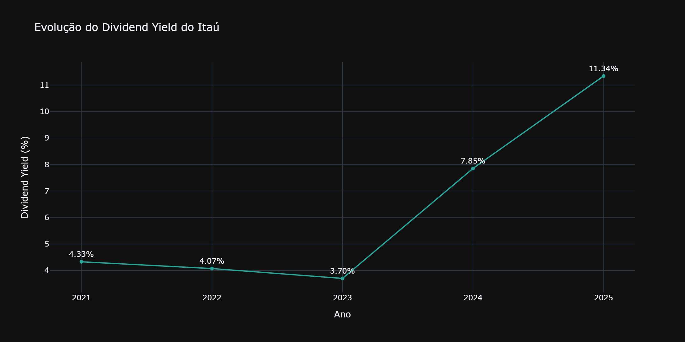
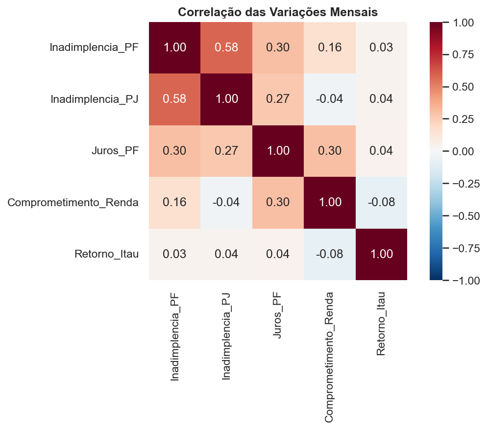

# Itaú (ITUB4) vs CDI: Desempenho, Volatilidade e Fundamentos 📊🏦

> Investir no Itaú teria compensado frente à renda fixa em 12 meses? Qual foi o risco no caminho e o que dizem os fundamentos do banco?



## Objetivo

Analisar a ação do Itaú Unibanco (**ITUB4**) por quatro ângulos e comparar o resultado com o **CDI**:

1. **Análise técnica:** tendência (médias móveis e cruzamentos) e volatilidade (Bandas de Bollinger).
2. **Rentabilidade comparada:** Itaú × CDI em base 100 e simulação de um aporte de R$ 4.000.
3. **Análise fundamentalista:** ROE, P/L, P/VP e Dividend Yield histórico.
4. **Contexto macro:** inadimplência, juros e comprometimento de renda no Sistema Financeiro Nacional.

## Principais resultados

Período analisado: **01/08/2025 a 31/07/2026** (250 pregões).

| Indicador | Resultado |
|---|---|
| Preço de fechamento | De R$ 31,02 para ≈ R$ 42,81 (**+38,0%**) |
| Faixa de fechamento no período | Mínimo R$ 31,02 (01/08/2025) e máximo R$ 48,34 (11/02/2026) |
| Itaú em base 100 (final) | **138,0** (chegou a 155,8 no pico) |
| CDI em base 100 (final) | **114,7** |
| Simulação de R$ 4.000 no Itaú | Pico de **R$ 6.232,52 (+55,8%)** e final de **R$ 5.520,09 (+38,0%)** |
| Cruzamentos de médias (SMA 21 × 50) | 3 *Golden Cross* e 3 *Death Cross* |
| Largura das Bandas de Bollinger | Média de 11,1%, pico de **27,4% em fev/2026** |
| ROE | **21,59%** (lucro líquido R$ 44,86 bi ÷ patrimônio líquido médio R$ 207,80 bi) |
| P/L | ≈ 9,96x |
| P/VP | ≈ 2,18x |
| Dividend Yield (2021 → 2025) | 4,33% · 4,07% · 3,70% · 7,85% · **11,34%** |

### O que a análise mostra

- **O Itaú superou o CDI, mas com muito mais risco:** a ação terminou em 138,0 contra 114,7 do CDI (cerca de 23 pontos à frente). No caminho, chegou a 155,8 e devolveu parte do ganho. A renda fixa subiu de forma estável o tempo todo.
- **Sinais de médias curtas geraram ruído:** dos 3 *Golden Cross* (nov/2025, abr/2026 e jul/2026), só o de **nov/2025** foi seguido de uma alta clara e duradoura. O de abr/2026 foi revertido em menos de 3 semanas. Cruzamentos de médias curtas (21 e 50 dias) são pouco confiáveis para esse ativo.
- **A volatilidade se concentrou no 1º trimestre de 2026:** a largura das Bandas de Bollinger chegou a 27,4% em fevereiro, durante a alta acelerada e a correção seguinte. Ao fim do período (5,7%), ela estava abaixo da largura inicial (10,4%).
- **Fundamentos sólidos:** ROE de 21,59% é alto para o setor. O P/L de ≈ 10x não indica ação cara nem barata, e o P/VP de ≈ 2,2x (ágio sobre o patrimônio) é coerente com a rentabilidade do banco (P/VP = P/L × ROE).
- **Dividendos em alta:** o Dividend Yield caiu levemente de 4,33% (2021) para 3,70% (2023) e depois saltou para 7,85% (2024) e **11,34% (2025)**. Os proventos por ação foram de R$ 1,11 (2023) para R$ 4,45 (2025).
- **Macro sem relação de curto prazo:** de 2011 a 2026, as correlações entre o retorno mensal da ação e as variações de inadimplência, juros e comprometimento de renda são praticamente nulas (|r| < 0,1).

## Etapas da análise

### 1. Análise técnica e tendências
- Médias móveis simples (SMA 21 e 50) e exponenciais (EMA 21 e 50).
- Cruzamentos entre SMA 21 e SMA 50 (*Golden Cross* e *Death Cross*), calculados só quando as duas médias já existem, para evitar sinais falsos no início da série.
- Bandas de Bollinger (20 períodos, 2 desvios-padrão) e largura relativa das bandas como medida objetiva de volatilidade.




### 2. Itaú vs CDI e simulação de carteira
- Retorno diário e acumulado do Itaú e simulação de **R$ 4.000** investidos em agosto de 2025.
- Taxa diária do CDI (série 12 do SGS) obtida pela API do Banco Central para o mesmo período.
- Normalização em **base 100** a partir da mesma data inicial.



### 3. Análise fundamentalista
- Lucro líquido (DRE) e patrimônio líquido (balanço) extraídos com `yfinance`.
- **ROE** sobre o patrimônio líquido médio dos dois últimos balanços; **P/L** e **P/VP** a partir do valor de mercado.
- Dividend Yield anual de 2021 a 2025: dividendos do ano ÷ preço de fechamento **não ajustado** do último pregão do ano.




### 4. Contexto macroeconômico
Séries do SGS/Bacen, que medem o **sistema financeiro como um todo** e não a carteira do Itaú:

| Código | Série |
|---|---|
| 21084 | Inadimplência da carteira de crédito: pessoas físicas |
| 21083 | Inadimplência da carteira de crédito: pessoas jurídicas |
| 20716 | Taxa média de juros das operações de crédito: pessoas físicas |
| 29034 | Comprometimento de renda das famílias com o serviço da dívida (com ajuste sazonal) |

A correlação é calculada sobre **variações mensais**, e não sobre níveis, para evitar correlações espúrias entre séries com tendência.



## Dados

| Fonte | O que foi usado |
|---|---|
| Yahoo Finance (`yfinance`) | Cotações diárias e mensais de ITUB4.SA, dividendos, DRE e balanço patrimonial |
| Banco Central do Brasil (`python-bcb`) | CDI (série 12), inadimplência PF/PJ, juros PF e comprometimento de renda |

Os dados são baixados por API a cada execução. O período de preços é fixo (definido na primeira célula do notebook), mas alguns valores podem variar um pouco:
- **P/L e P/VP** usam o valor de mercado do dia em que o notebook é executado (os números acima são de 07/11/2026).
- O Yahoo Finance **reajusta preços antigos** sempre que há novos proventos.

## Tecnologias

Python · Pandas · NumPy · yfinance · python-bcb · Plotly · Matplotlib · Seaborn · Jupyter Notebook

## Como executar

```bash
git clone https://github.com/Vitor-neia/Analise-itub4-macroeconomia.git
cd Analise-itub4-macroeconomia
pip install -r requirements.txt
jupyter notebook "Análise ITUB4/Analise.ipynb"
```

Para mudar o período ou o valor do aporte, altere `INICIO`, `FIM` e `APORTE_INICIAL` na primeira célula de código.

## Estrutura do repositório

```
├── Análise ITUB4/
│   └── Analise.ipynb    # notebook com toda a análise
├── img/                 # gráficos usados neste README
├── requirements.txt
└── README.md
```

## Limitações

- **Período curto:** 12 meses não bastam para concluir sobre o desempenho de longo prazo do Itaú nem do CDI.
- **Sem impostos e custos:** o comparativo não considera imposto de renda, corretagem nem taxas.
- **Preço ajustado:** na comparação com o CDI, a série do `yfinance` é ajustada por proventos. Ou seja, o retorno do Itaú já considera dividendos e JCP reinvestidos, e o CDI é bruto.
- **Sinais técnicos não são previsão:** os cruzamentos de médias são descritivos e foram avaliados só neste período, sem teste fora da amostra.
- **Um único ativo:** os fundamentos de um banco não representam o setor.

## ⚠️ Aviso legal

Projeto de caráter **estritamente educacional**, desenvolvido para demonstrar habilidades em análise de dados. Os resultados **não constituem recomendação** de compra, venda ou manutenção de ativos financeiros, e desempenho passado não garante resultados futuros.

**Autor:** Vitor Augusto Neias · [LinkedIn](https://www.linkedin.com/in/vitor-augusto-neias-278a91210/) · [Portfólio](https://vitorneiadata.com.br)
